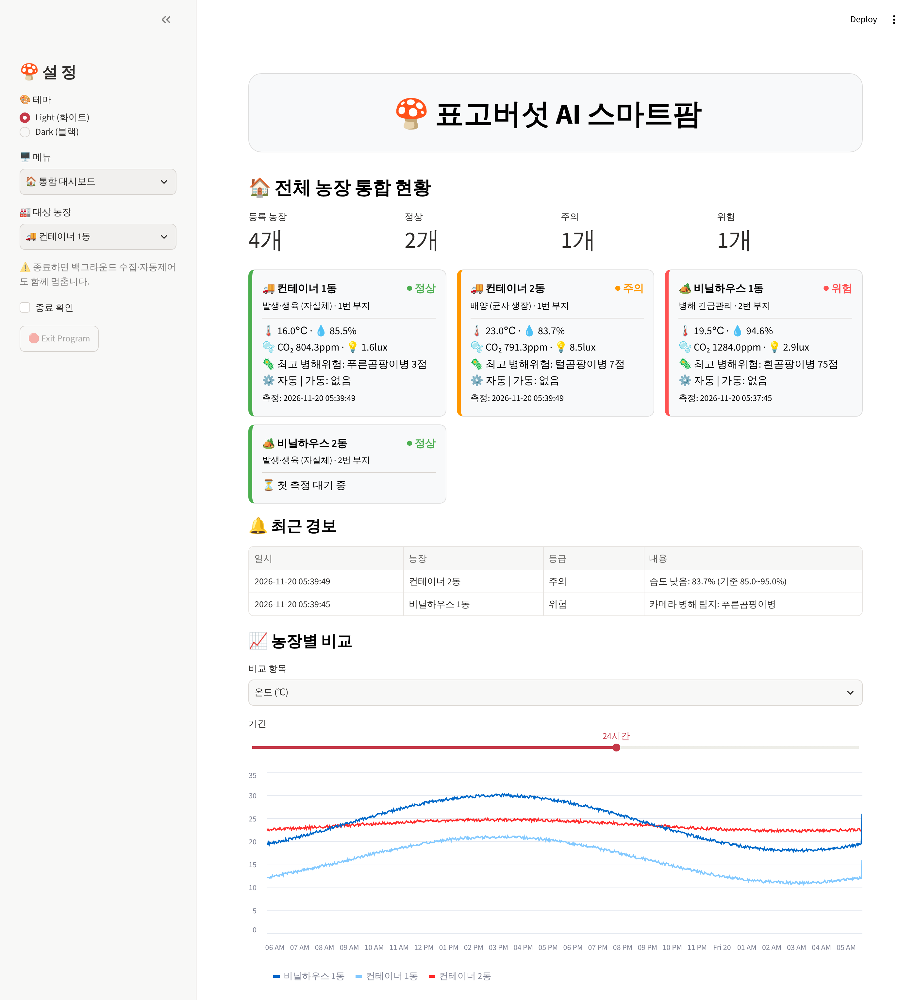
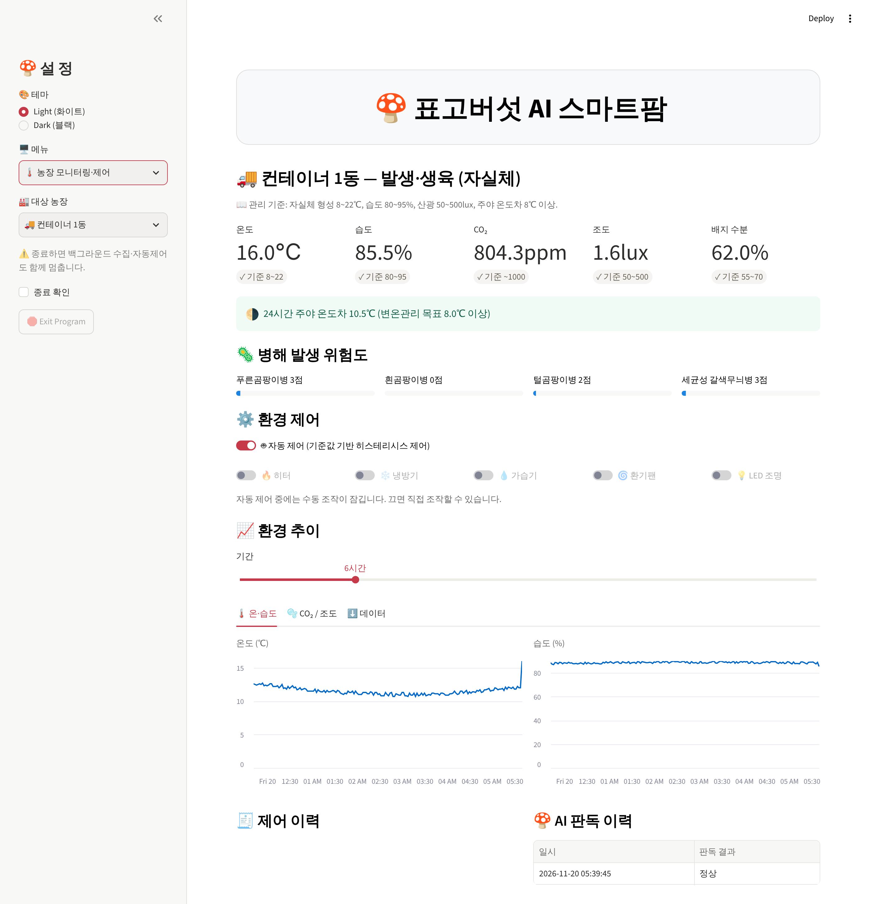
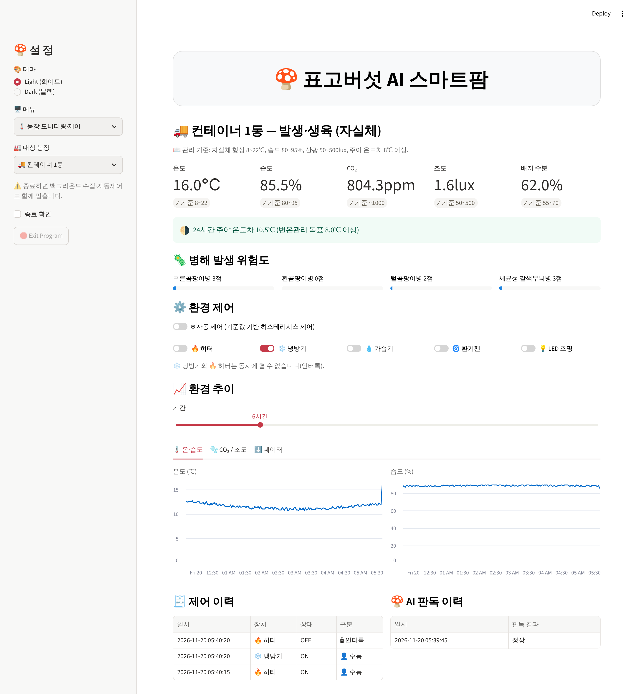
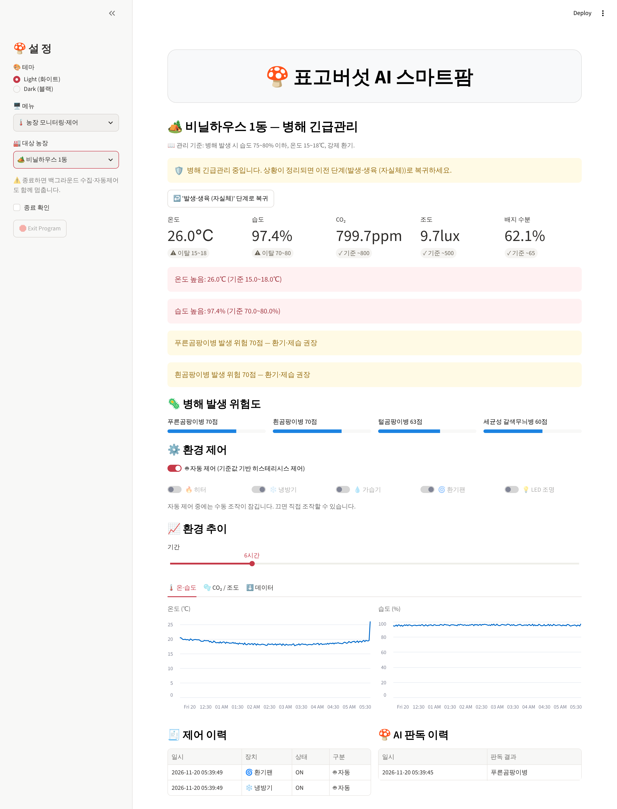
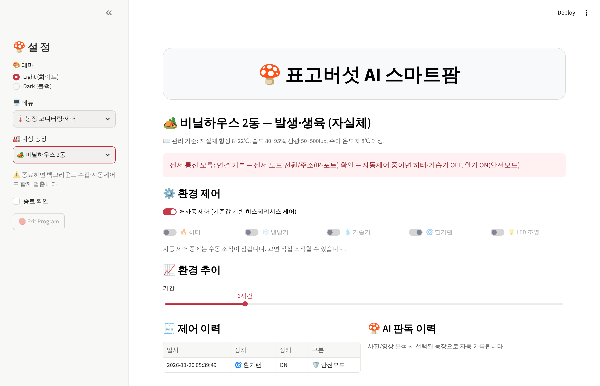
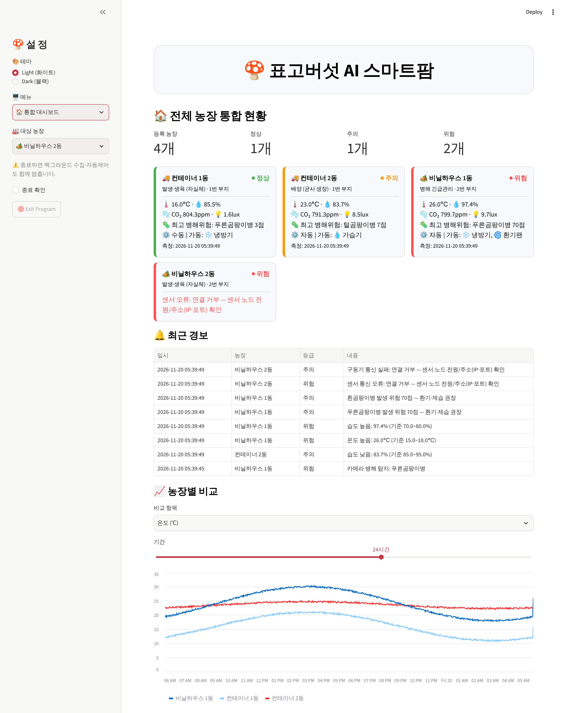
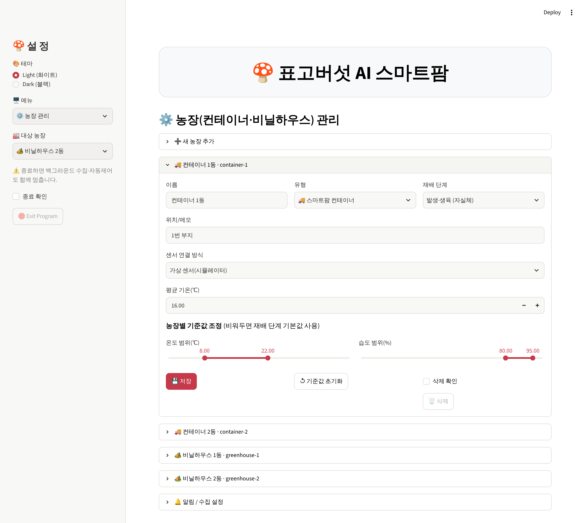
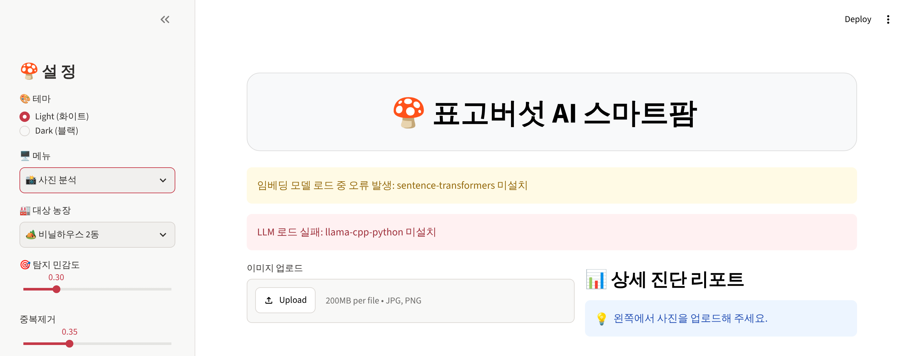
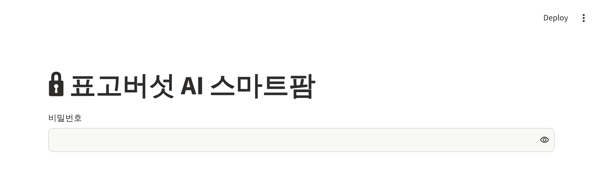

# 기능별 화면

> 가상 센서(시뮬레이터) + 26시간 분량 예시 데이터로 촬영. 비닐하우스 2동은 센서 고장 상황을 재현하려고 존재하지 않는 주소로 연결함.

## 1. 통합 대시보드
4개 동 상태를 정상·주의·위험으로 구분하고, 최근 경보와 농장 간 비교 그래프를 보여줍니다.

## 2. 농장 모니터링 (자동 제어)
센서값과 기준 충족 여부(✓/⚠), 24시간 주야 온도차(변온관리), 병해 위험도, 온도·습도·CO₂·조도 추이를 보여줍니다.

## 3. 수동 제어 + 인터록
자동 제어를 끄고 히터를 켠 뒤 냉방기를 켜면 히터가 자동으로 꺼집니다.

## 4. 병해 긴급관리 모드
고온·고습으로 병해 위험이 높은 동입니다. 긴급관리 기준(15~18℃, 습도 70~80%)에 맞춰 냉방기·환기팬이 자동으로 돌고, 이전 단계로 돌아가는 '복귀' 버튼이 있습니다.

## 5. 센서 고장 → 안전모드
센서와 연결이 끊기면 원인을 알기 쉬운 문구로 안내하고, 히터·냉방기·가습기를 끄고 환기팬을 켭니다. 제어 이력의 '구분'에는 '안전모드'로 기록됩니다.

## 6. 조작 후 대시보드

## 7. 농장 관리
농장 추가·수정·삭제(삭제 확인 체크 필요), 유형·재배 단계·센서 연결 방식·농장별 기준값을 설정합니다.

## 8. 사진 분석
AI 모델(YOLO·LLM)이 없는 환경이라 업로드 화면까지만 촬영했습니다. 모델이 없다는 안내가 정상적으로 표시됩니다.

## 9. 접속 비밀번호
환경변수 `SMARTFARM_PASSWORD`를 설정하면 로그인 화면이 먼저 나옵니다.

